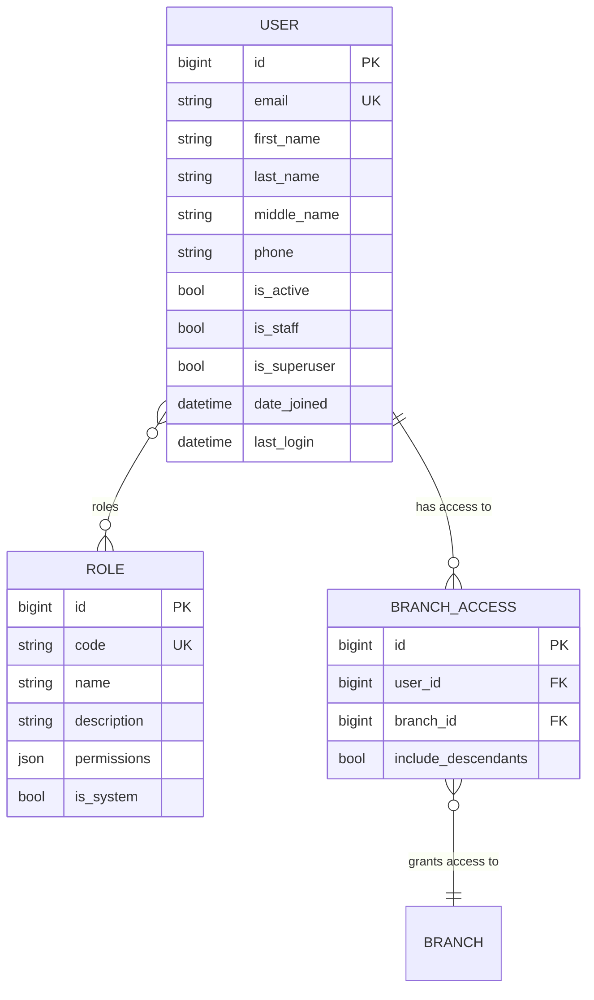
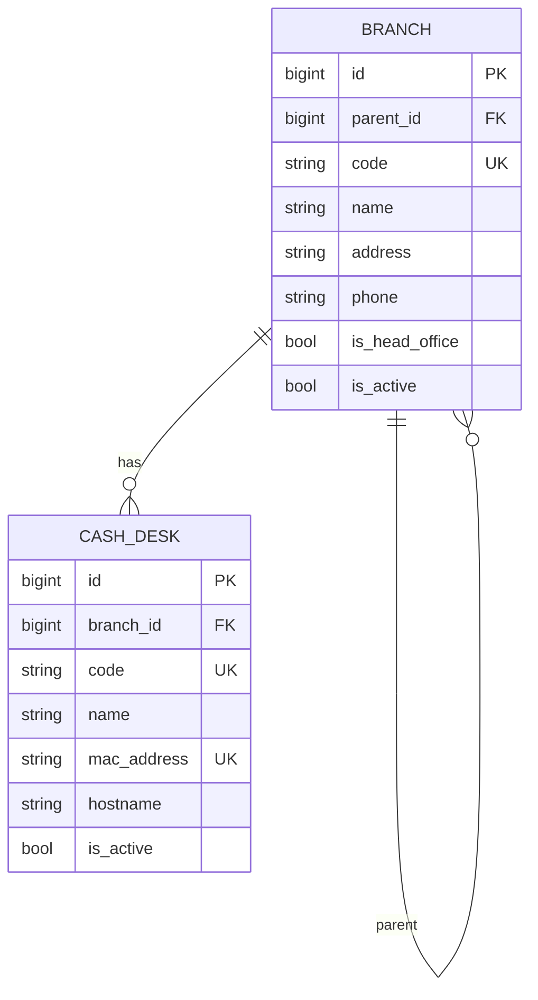
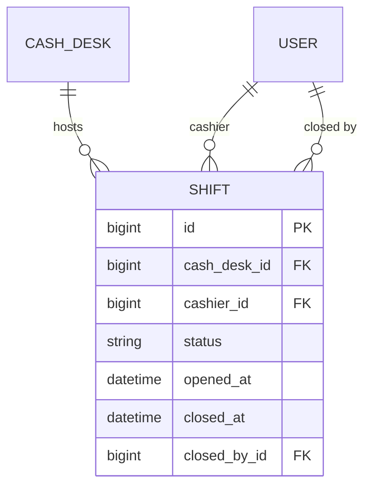

# Архитектура модуля core

Модуль `core` — ядро продукта: пользователи, аутентификация, управляемые данными
роли и права, оргструктура (отделения и кассы) и кассовые смены.

Этот документ описывает **устройство модуля**: его сущности, правила и границы.
Общая архитектура продукта — в `docs/architecture.md`, правила построения модулей,
контракты и манифест — в `docs/modules.md`, архитектурные решения — в `docs/adr/`.

## Роли и права

Роли **управляются данными**: они хранятся в таблице `Role` и настраиваются
администратором в интерфейсе, а не зашиты в код. У пользователя может быть
**несколько ролей** (`User.roles` — связь многие-ко-многим).

Каждая роль несёт набор **кодов прав** из каталога
(`modules/core/backend/permission_codes.py`) — например `core.users.manage`
или `core.shifts.open`. Права, выданные всеми ролями пользователя, объединяются:
метод `User.has_permission(code)` возвращает `True`, если код входит в объединение
(суперпользователь имеет все права).

При поставке создаются четыре системные роли: **Администратор**,
**Заведующий отделением**, **Специалист**, **Кассир**. Системные роли нельзя
удалить, но можно переименовать и изменить их права.

Доступ к эндпоинтам проверяет класс `modules.core.backend.permissions.PermissionRequired`,
который сопоставляет действие с кодом права (карта `permission_map` на вьюхе).
Меню и маршруты SPA фильтруются по тем же кодам прав.

## Схема данных

Сущности модуля сгруппированы в несколько диаграмм по смыслу: **идентичность и
доступ**, **оргструктура** и **кассовые смены**. Связи между сущностями разных
диаграмм показаны на каждой из них.

### Идентичность и доступ

Пользователь идентифицируется по email (поле `username` не используется), может
иметь несколько ролей и список доступных ему отделений.

Удаление пользователя по умолчанию **мягкое** — учётная запись деактивируется
(`is_active = false`), запись сохраняется для аудита. Полное удаление доступно
по `?permanent=true`.

### Оргструктура

Отделения образуют дерево с единственным головным офисом; касса — рабочее место
кассира (один ПК), привязанное к отделению.

- Отделения образуют **дерево с единственным головным офисом** (`is_head_office`).
  Ветка не может быть своим предком (проверка при сохранении), глубину не
  ограничиваем. Код отделения — сквозной (`unique`).
- **Касса — это компьютер** (одна касса на один ПК). MAC-адрес хранится как
  учётный атрибут рабочего места (`unique`); автоматическое определение кассы по
  MAC отложено, кассир выбирает кассу вручную при открытии смены.

### Кассовые смены

Смена — серверный объект, независимый от сессии/браузера; она привязана к кассе
и кассиру.

- касса выбирается один раз при **открытии смены** и фиксируется на всю жизнь смены;
- одновременно допускается не более **одной открытой смены на кассира** и
  **одной открытой смены на кассу** (частичные уникальные ограничения);
- перезагрузка ПК, потеря токена, несколько вкладок — не влияют на смену;
- забытую смену может закрыть администратор или заведующий отделением
  (право `core.shifts.manage`); авто-закрытия нет.

## Доступные отделения

Каждый пользователь (независимо от роли) видит только **доступные ему
отделения**. Доступ настраивает администратор банка (право `core.users.manage`).

- Доступ — это набор записей `BranchAccess` «пользователь → отделение». У каждой
  записи есть флаг `include_descendants`: если он включён, доступны и все
  дочерние отделения выбранного (рекурсивно).
- Доступные отделения пользователя — объединение по всем его записям.
- **Суперпользователь** (`is_superuser`) видит все отделения всегда.
- **Deny-by-default:** если у пользователя нет ни одной записи, он не видит ни
  одного отделения.

Область доступа применяется к чтению и фильтрации объектов (смены, кассы,
отделения) и к выбору рабочего места. При этом:

- **Чтение не зависит от активности.** Деактивация отделения не удаляет записи
  доступа, и ранее выполненную работу (смены) по неактивному отделению
  по-прежнему видно.
- **Запись требует активности.** Открыть смену можно только на кассе активного
  отделения (и активной кассы), к которому у пользователя есть доступ.

Каталог отделений **для назначения доступа** отдаётся целиком (все отделения),
независимо от личной области администратора, — иначе настройка была бы
невозможна при пустом доступе. Личная область влияет только на операционные
данные (смены, кассы, `selectable`).

Централизованные правила области видимости собраны в
`modules/core/backend/scoping.py`; `selectable`-эндпоинты и открытие смены
дополнительно проверяют активность.
