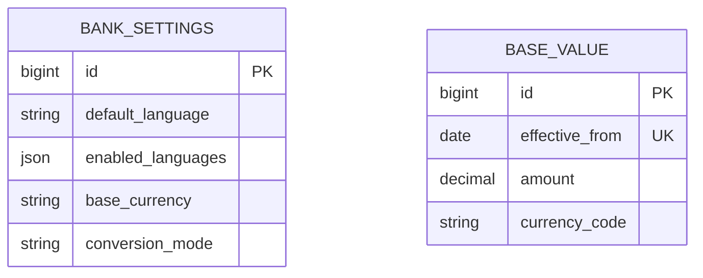
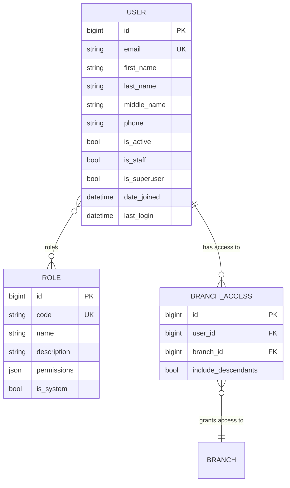
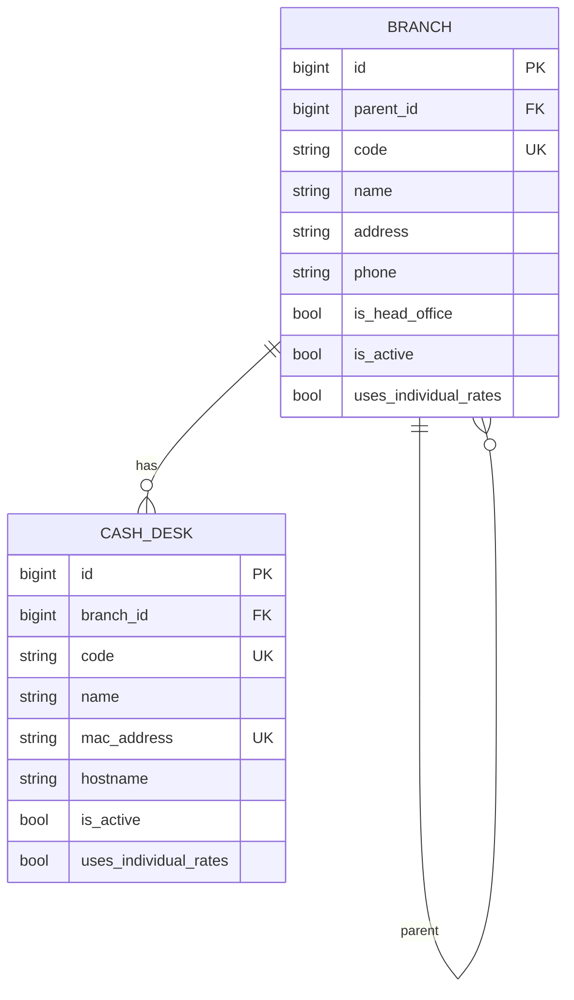
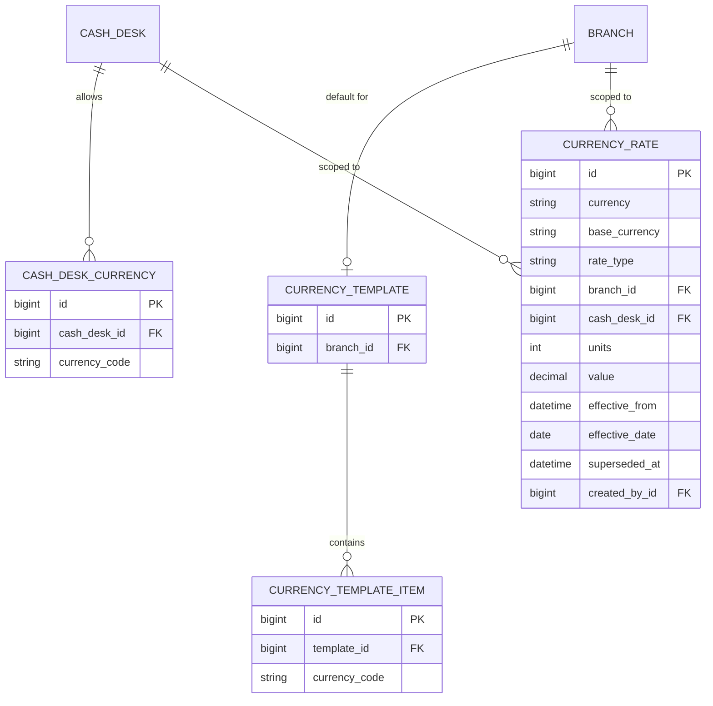
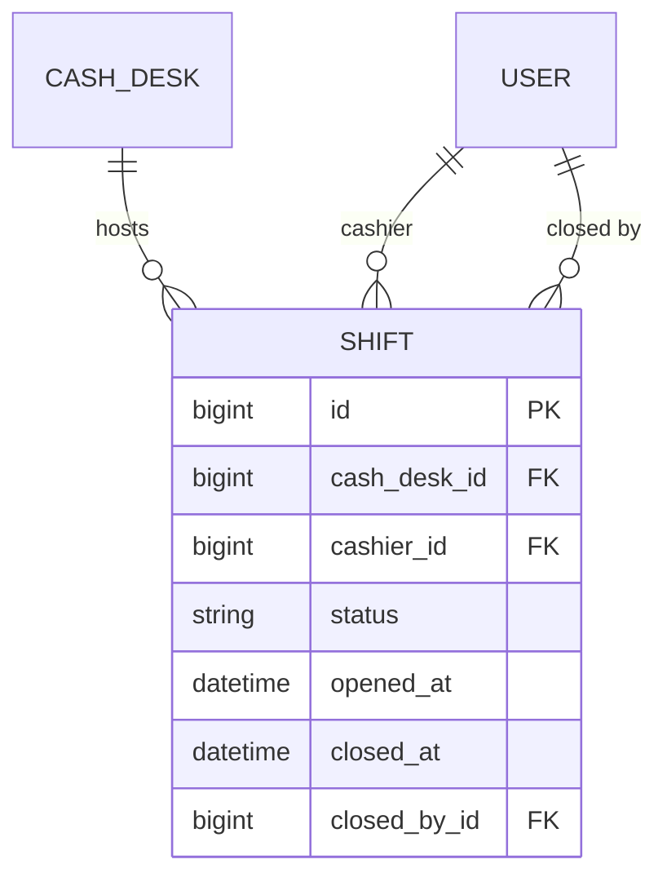

# Архитектура модуля core

Модуль `core` — ядро продукта: пользователи, аутентификация, управляемые данными
роли и права, оргструктура (отделения и кассы) и кассовые смены.

Этот документ описывает **устройство модуля**: его сущности, правила и границы.
Общая архитектура продукта — в `docs/architecture.md`, правила построения модулей,
контракты и манифест — в `docs/modules.md`, архитектурные решения — в `docs/adr/`.

## Роли и права

Роли **управляются данными**: они хранятся в таблице `Role` и настраиваются
администратором в интерфейсе, а не зашиты в код. У пользователя может быть
**несколько ролей** (`User.roles` — связь многие-ко-многим).

Каждая роль несёт набор **кодов прав** из каталога
(`modules/core/backend/permission_codes.py`) — например `core.users.manage`
или `core.shifts.open`. Права, выданные всеми ролями пользователя, объединяются:
метод `User.has_permission(code)` возвращает `True`, если код входит в объединение
(суперпользователь имеет все права).

Каталог прав **собирается из модулей**: `core` объявляет свои коды, соседние
модули — свои (например, `operations.*`), а интерфейс ролей и валидация роли
показывают объединение (`docs/adr/0012-permission-catalog-aggregation.md`).

При поставке создаются четыре системные роли: **Администратор**,
**Заведующий отделением**, **Специалист**, **Кассир**. Системные роли нельзя
удалить, но можно переименовать и изменить их права.

Доступ к эндпоинтам проверяет класс
`modules.common.backend.permissions.PermissionRequired`, который сопоставляет
действие с кодом права (карта `permission_map` на вьюхе). Класс общий: им
пользуются все модули. Меню и маршруты SPA фильтруются по тем же кодам прав.

Для оргструктуры просмотр и изменение разделены: `core.structure.view`
открывает списки отделений и касс (в пределах `BranchAccess`), а
`core.structure.manage` — создание, изменение и удаление. SPA показывает
кнопки редактирования только при наличии права изменения. Формы редактирования
запрашивают полное дерево отделений (`GET /api/branches/structure-options/`):
держатель права изменения выбирает любое отделение, даже вне своей области
видимости.

## Язык и локализация

Пользователь имеет поле `language` (пусто — язык по умолчанию банка), а синглтон
`BankSettings` хранит `default_language` и `enabled_languages`. Язык ответа
определяется заголовком `Accept-Language` (активируется `LocaleMiddleware`),
персональный выбор — полем пользователя, дефолт банка — fallback
(см. `docs/adr/0015-application-language-layers.md`). Значение `language`
валидируется по списку `enabled_languages`.

## Настройки банка и базовые величины

Синглтон `BankSettings` хранит глобальные константы банка. Кроме языков он задаёт
**национальную (базовую) валюту** (`base_currency`); она используется как базовая
для курсов, порогов и базовых величин. Читать настройки может любой клиент
(публичный `GET /api/settings/`), изменять — администратор с правом
`core.bank_settings.manage`.

`BaseValue` — справочник базовых величин банка:

- у записи есть `effective_from` (дата начала действия) и `amount`;
- дата уникальна, будущие значения можно вводить заранее;
- `currency_code` — снимок национальной валюты на момент создания записи;
- действующее значение на дату — запись с наибольшей `effective_from`, не
  превышающей эту дату;
- вступившие в силу записи **не изменяются и не удаляются** (append-only);
  исправление — новая запись с более поздней датой.

Смена `base_currency` запрещена, пока существуют курсы или базовые величины в
другой валюте: исторические суммы нельзя молча переинтерпретировать.

`conversion_mode` задаёт способ пересчёта между валютами: `via_base` — через
национальную валюту, `direct` — прямыми парами (например, `EUR/USD`). Режим
можно переключать; прямые курсы остаются в журнале, но в `via_base` не
участвуют в разрешении и не показываются в текущих курсах.

## Публичный контракт

Модуль публикует в реестре (`modules.common.contracts.registry`) три сервиса;
другие модули используют только их, а не модели `core`:

- `core.users` (`UserDirectory`) — чтение пользователя, проверка прав и админа;
- `core.org` (`OrgDirectory`) — открытая смена кассира, доступные кассы и
  отделения, проверка доступа к кассе, путь по дереву отделений (`branch_ancestor_ids`);
- `core.cash_desk_config` (`CashDeskConfigDirectory`) — **действующие** валюты
  кассы и действующие курсы с учётом банка, отделений, касс и флагов
  индивидуальных курсов;
- `core.bank_settings` (`BankSettingsDirectory`) — национальная валюта, режим
  конверсии и действующая на дату базовая величина (для порогов и расчётов
  других модулей).

`core.users` и `core.org` нужны модулю `operations`; `core.cash_desk_config` — для
проверки доступных кассе валют при проведении (возвращает эффективный набор,
пустой = ничего не разрешено). Сам справочник валют и типы курсов живут в модуле
`references` (контракт `references.directory`) — см.
`docs/adr/0017-references-module.md`.

## Схема данных

Сущности модуля сгруппированы в несколько диаграмм по смыслу: **идентичность и
доступ**, **оргструктура** и **кассовые смены**. Связи между сущностями разных
диаграмм показаны на каждой из них. Все они хранятся в схеме PostgreSQL `core`
(см. `docs/adr/0013-postgresql-schemas-per-module.md`).

### Идентичность и доступ

Пользователь идентифицируется по email (поле `username` не используется), может
иметь несколько ролей и список доступных ему отделений.

Удаление пользователя по умолчанию **мягкое** — учётная запись деактивируется
(`is_active = false`), запись сохраняется для аудита. Полное удаление доступно
по `?permanent=true`.

### Оргструктура

Отделения образуют дерево с единственным головным офисом; касса — рабочее место
кассира (один ПК), привязанное к отделению.

- Отделения образуют **дерево с единственным головным офисом** (`is_head_office`).
  Ветка не может быть своим предком (проверка при сохранении), глубину не
  ограничиваем. Код отделения — сквозной (`unique`).
- **Касса — это компьютер** (одна касса на один ПК). MAC-адрес хранится как
  учётный атрибут рабочего места (`unique`); автоматическое определение кассы по
  MAC отложено, кассир выбирает кассу вручную при открытии смены.
- **Индивидуальные курсы.** Флаг `uses_individual_rates` у отделения или кассы
  отключает для них курсы вышестоящих уровней. У кассы — только её курсы; у
  отделения — его курсы и курсы нижестоящих подразделений, без курсов банка и
  родительских отделений.

### Валюты и курсы

Справочник валют ISO 4217 и типы курсов вынесены в модуль `references`
(`docs/adr/0017-references-module.md`); `core` ссылается на валюту и тип курса
**по коду** (строкой), а не внешним ключом. В `core` остаются конфигурация кассы
и курсы:

- валюты, включённые на конкретной кассе (`CashDeskCurrency.currency_code`);
- **шаблоны комплектации** (банк и отделение) — `CurrencyTemplate` и её элементы
  `CurrencyTemplateItem.currency_code`;
- курсы (`CurrencyRate` — `currency`, `base_currency`, `rate_type` как коды).

Действующий набор валют кассы вычисляется **динамически**: своя настройка кассы →
ближайший определённый шаблон по пути «отделение → … → банк» → при отсутствии
шаблонов **валюты не разрешены** (deny-by-default). Пустой шаблон также запрещает
все валюты. Правило и обоснование — в
`docs/adr/0014-cash-desk-configuration-templates.md`.

Курсы задаются **на трёх уровнях**: банк, отделение, касса. Уровень определяют
поля `branch` и `cash_desk` (ровно одно из них или ни одного). Курс нижнего
уровня **перекрывает** курс верхнего; порядок разрешения — касса → её отделение →
родительские отделения → банк. Флаги `uses_individual_rates` отсекают
вышестоящие уровни.

Курс задаётся за количество **единиц** валюты (`units`, по умолчанию 1), например
за 100 RUB. В записи хранится котировка за `units` единиц; контракт
`core.cash_desk_config.rate` возвращает значение, нормализованное к одной
единице. Обычные курсы и конверсия через базовую валюту котируются к
национальной валюте. В режиме `direct` конверсия задаётся прямой парой
(`currency = EUR`, `base_currency = USD`, то есть `1 EUR = X USD`).

Пара хранится двумя независимыми котировками — системные типы
`conversion_buy` («Покупка (конверсия)») и `conversion_sell` («Продажа
(конверсия)»); обе разрешаются через `resolve` с `target_currency` и
устанавливаются одним запросом `POST /api/currency-rates/conversion-bulk/`
(сервис `rates.bulk_set_conversion_pairs`). Разделение на два типа сохраняет
симметрию с обычными курсами покупки и продажи и позволяет операциям выбирать
нужную сторону пары.

Тип курса задаёт форму хранения: для `calendar_day` действует один курс на
календарный день и область (в записи хранится `effective_date`, а
`effective_from` нормализуется на начало локального дня); для `since_set`
применяется запись с наибольшим `effective_from` не в будущем. Для
`calendar_day` исправление создаёт новую версию и помечает прежнюю
`superseded_at`; журнал сохраняет все версии. Курс Нацбанка задаётся только на
уровне банка.

Базовая валюта банка хранится в настройках банка (`BankSettings.base_currency`).
Разрешение курса доступно модулям через контракт `core.cash_desk_config`
(`rate`, `cash_desk_rates`). `rate` принимает `target_currency` для прямых
кросс-курсов и возвращает значение за одну единицу.

`currency_code` / `currency` / `base_currency` — коды из справочника
`references`; `rate_type` — код банковского типа курса из `references`.
Поставляется полный список действующих кодов ISO 4217 (команда
`seed_iso_currencies`); перевод названий — в модуле `references`
(`docs/adr/0016-translatable-reference-data.md`).

Права на курсы: `core.currency_rates.view` — просмотр журнала и текущих курсов;
`core.currency_rates.manage` — курсы банка; `.manage.branch` — курсы доступных
отделений и их касс; `.manage.cash_desk` — касса открытой смены; `.manage.official`
— курс Нацбанка (только банк). Правила и API — в `docs/api.md`.

### Кассовые смены

Смена — серверный объект, независимый от сессии/браузера; она привязана к кассе
и кассиру.

- касса выбирается один раз при **открытии смены** и фиксируется на всю жизнь смены;
- одновременно допускается не более **одной открытой смены на кассира** и
  **одной открытой смены на кассу** (частичные уникальные ограничения);
- перезагрузка ПК, потеря токена, несколько вкладок — не влияют на смену;
- забытую смену может закрыть администратор или заведующий отделением
  (право `core.shifts.manage`); авто-закрытия нет;
- открытие и закрытие смены публикуют доменные события `core.shift.opened` /
  `core.shift.closed` (outbox, `docs/adr/0009-domain-events-outbox.md`) — на них
  может подписаться модуль `operations`.

## Доступные отделения

Каждый пользователь (независимо от роли) видит только **доступные ему
отделения**. Доступ настраивает администратор банка (право `core.users.manage`).

- Доступ — это набор записей `BranchAccess` «пользователь → отделение». У каждой
  записи есть флаг `include_descendants`: если он включён, доступны и все
  дочерние отделения выбранного (рекурсивно).
- Доступные отделения пользователя — объединение по всем его записям.
- **Суперпользователь** (`is_superuser`) видит все отделения всегда.
- **Deny-by-default:** если у пользователя нет ни одной записи, он не видит ни
  одного отделения.

Область доступа применяется к чтению и фильтрации объектов (смены, кассы,
отделения) и к выбору рабочего места. При этом:

- **Чтение не зависит от активности.** Деактивация отделения не удаляет записи
  доступа, и ранее выполненную работу (смены) по неактивному отделению
  по-прежнему видно.
- **Запись требует активности.** Открыть смену можно только на кассе активного
  отделения (и активной кассы), к которому у пользователя есть доступ.

Каталог отделений **для назначения доступа** отдаётся целиком (все отделения),
независимо от личной области администратора, — иначе настройка была бы
невозможна при пустом доступе. Личная область влияет только на операционные
данные (смены, кассы, `selectable`).

Централизованные правила области видимости собраны в
`modules/core/backend/scoping.py`; `selectable`-эндпоинты и открытие смены
дополнительно проверяют активность.
