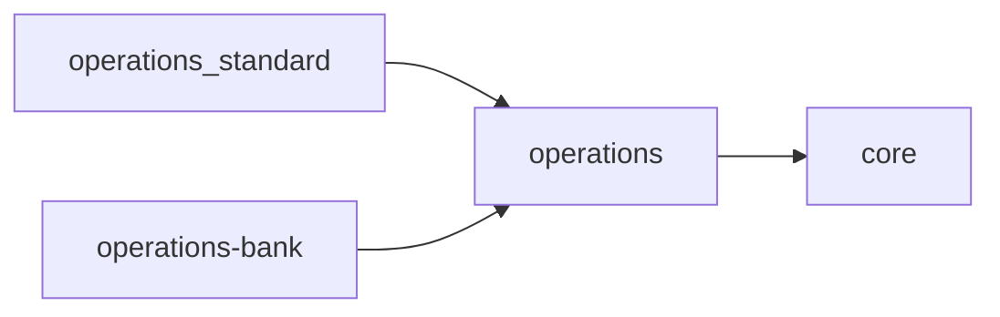

# Архитектура модуля operations_standard

Модуль `operations_standard` — **базовый набор кассовых операций**: типовые
операции прихода, расхода и обмена, которые входят в поставку «из коробки».

Этот документ описывает **устройство модуля**. Общая архитектура продукта — в
`docs/architecture.md`, правила построения модулей — в `docs/modules.md`, движок и
SPI — в `docs/architecture-module-operations.md`, решения — в `docs/adr/`.

## Место среди модулей

`operations_standard` — модуль-сиблинг движка `operations`: он зависит от
`operations` только по контракту и **не владеет собственными таблицами**. Задача
модуля — объявить типы операций; хранит и выполняет их движок
(`docs/adr/0006-operations-extensibility-spi.md`).

## Как модуль объявляет операции

Каждая операция описывается декларативно — слотами сумм и шаблоном проводок
(`OperationTypeSpec`), без кода-обработчика:

- **приход/расход** — один слот `amount`, проводки `cash` и `turnover` с нужным
  знаком;
- **обмен** — слоты `received` и `issued`, проводки `cash`/`turnover` в двух
  направлениях.

Объявления лежат в `modules/operations_standard/backend/declarations.py`. В
`AppConfig.ready()` модуль регистрирует их в SPI-реестре `operations` (имя
`operations.types`). Хранит объявления у себя `operations`: по команде
`sync_operation_types` они создаются/обновляются в его таблицах
(`OperationType`, `SlotDef`). Команда выполняется при старте backend (entrypoint,
после миграций) и идемпотентна.

Важно: модуль импортирует у соседа **только** `modules.operations.contracts` —
ни моделей, ни таблиц `operations` он не касается (`docs/modules.md`, инвариант 1).

## Базовый набор

На текущий момент объявлено **16** операций:

| Вид | Операции |
| --- | --- |
| Приход | подкрепление кассы, приход наличных, коммунальные платежи, погашение кредита, пополнение вклада, приём комиссии |
| Расход | выдача наличных, снятие вклада, выдача кредита, выплата зарплаты, выплата пенсии, инкассация кассы |
| Обмен | продажа валюты, покупка валюты, конвертация, покупка дробной части валюты |

Операции, определяемые только в национальной валюте, объявляют слот с
фиксированной валютой (`BYN`); остальные принимают валюту как параметр слота.
Набор расширяется добавлением объявлений — без изменения движка.

## Формы операций

Объявление задаёт не только проводки, но и форму ввода. Это остаётся данными:

| Форма | Объявление |
| --- | --- |
| `amount` | один слот `amount` (или слоты с фиксированной валютой) |
| `multi_currency` | слот `amount` с `multiple = true`: подкрепление и инкассация принимают по строке на каждую валюту кассы |
| `exchange` | слоты `received` и `issued`; одна сторона хранит курс (`stores_rate`), вторая вычисляется (`amount_mode = computed`) |

Направление курса объявляется в `rate_principle`: `buy` для покупки валюты у
клиента, `sell` для продажи, `conversion` для конвертации. Конкретный
банковский тип курса администратор выбирает в настройках типа операции; без
него операция обмена не проводится.

## Что сюда не входит

- **Вычисляемые и внешние операции** (например, с обращением к АСУ банка по
  REST) реализуются кодом-обработчиком и добавляются модулями расширения
  (`docs/adr/0011-external-operations.md`), а не `operations_standard`.
- Собственные модели, API и страницы: модуль объявляет данные и не публикует
  собственный контракт (`frontend_routes: false`).

## Ключевые точки входа

- Манифест: `modules/operations_standard/module.yaml`
- Приложение (регистрация объявлений): `modules/operations_standard/backend/apps.py`
- Объявления типов: `modules/operations_standard/backend/declarations.py`
