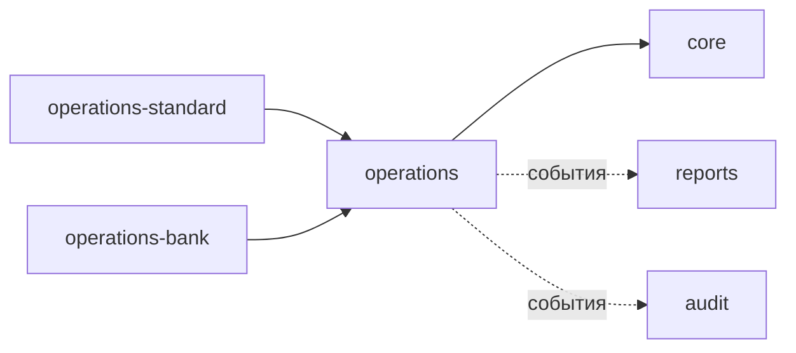
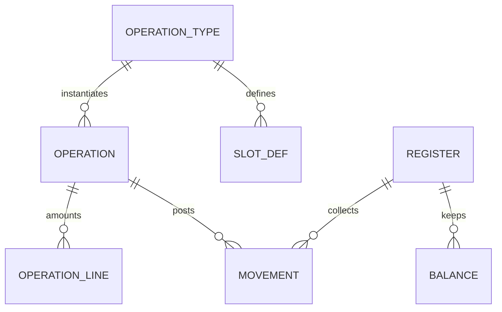
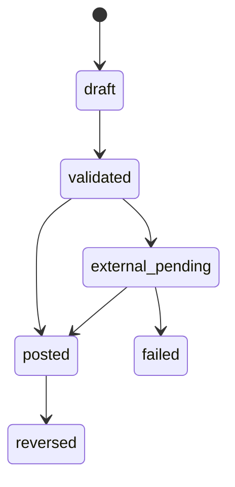

# Архитектура модуля operations

Модуль `operations` — ядро операционного учёта кассовых операций банка: движок
проведения, регистры и остатки наличных, журнал операций и каталог типов операций.

Этот документ описывает **устройство модуля**: его сущности, правила и границы.
Общая архитектура продукта — в `docs/architecture.md`, правила построения модулей,
контракты и манифест — в `docs/modules.md`, архитектурные решения — в `docs/adr/`.

`operations` — **только движок**. Конкретные операции вынесены в отдельные модули:
базовый набор — в `operations-standard`, операции под конкретный банк — в модули
расширения (`operations-<bank>`). Оба вида зависят от `operations` по контракту
и используют SPI (см. `docs/adr/0006-operations-extensibility-spi.md`).

## Границы и зависимости

- `operations` зависит от `core`: касса, смена, пользователь/право, валюты и
  курсы (только через контракт, см. `docs/adr/0007-currencies-and-rates-in-core.md`
  и `docs/adr/0019-currency-rate-setting.md`).
- Расширения зависят от `operations` по контракту и **наполняют** его SPI-реестр
  (обратная сторона контрактного реестра `modules.common.contracts.registry`).
- Наружу модуль публикует пакет `modules.operations.contracts` и доменные события
  `operations.operation.posted`, `operations.operation.reversed`
  (`docs/adr/0009-domain-events-outbox.md`).

## Модель учёта

Учёт строится на **регистрах накопления** (измерения + ресурсы), без плана счетов
и двойной записи (см. `docs/adr/0004-operational-accounting-registers.md`).

| Сущность | Назначение |
| --- | --- |
| `OperationType` | Метаданные типа операции: код, вид, слоты сумм, флаги, право, шаблон проводок, признак внешней операции |
| `SlotDef` | Описание слота суммы типа операции (какие суммы и валюты ожидаются) |
| `OperationTypeSettingsChange` | История изменений настроек типа: дата, пользователь, значения «до/после» |
| `Operation` | Неизменяемый документ: тип, касса, смена, кассир, клиент (снимок), статус, номер, время |
| `OperationLine` | Сумма операции: слот → валюта → сумма (+ курс) |
| `Movement` | Проводка: регистр + измерения + знаковая сумма |
| `Register` / `Balance` | Регистр и материализованный остаток (быстрый доступ и проверка) |

- Стартовые регистры: `cash` (остаток наличных: касса + валюта) и `turnover`
  (обороты: касса + валюта + вид операции). Набор расширяется.
- Проводки — **источник истины**, остаток (`Balance`) — производное и
  восстановимое значение.
- Поле «место хранения» в проводке задаётся ссылкой на справочник (сейчас — касса),
  чтобы позже перейти на учёт по отделению без изменения модели
  (`docs/adr/0005-multicurrency-cash-balances.md`).

## Типы операций и SPI

- **Тип операции = данные + код.** Метаданные (слоты сумм, шаблон проводок, флаги)
  хранятся как данные; обработчик — чистая функция `OperationRequest → PostingPlan`,
  которая **описывает** проводки и не пишет в таблицы `operations`. План применяет
  движок. Простые операции задаются декларативно (шаблон проводок в типе), код
  нужен только для вычисляемых и внешних операций.
- **SPI** публикуется в `modules.operations.contracts`. Расширение объявляет тип
  (`OperationTypeSpec` со слотами `SlotSpec` и шаблоном) и, при необходимости,
  обработчик `OperationHandler`, регистрируя их в реестре `operations.types`
  (`AppConfig.ready()`). Публикуются также `OperationTypeDTO`, `OperationRequest`,
  `PostingPlan`, `MovementSpec`, `RegisterCode`.
- **Локализация.** Названия типов и слотов — базовые (русские); переводы хранятся
  в `OperationTypeTranslation`/`SlotDefTranslation` и синхронизируются из объявлений
  (`OperationTypeSpec.translations`, `SlotSpec.translations`), отдаются на языке
  запроса (см. `docs/adr/0016-translatable-reference-data.md`).
- **Хранит типы `operations`.** По команде `sync_operation_types` объявленные типы
  создаются/обновляются в таблицах `operations`; команда идемпотентна и
  выполняется при старте (entrypoint, после миграций). Так соблюдается правило
  «данные принадлежат модулю»: расширение объявляет, а не пишет в чужие таблицы.
- Контракт SPI версионируется по semver; ломающие изменения — только в новой
  мажорной версии модуля.

## Жизненный цикл операции

- Проведение выполняется в одной транзакции: проверка остатков, блокировка строк
  остатков (`SELECT ... FOR UPDATE`) в детерминированном порядке, запись проводок,
  обновление остатков и публикация события.
- Проведённая операция **неизменяема**; исправление — сторно (обратные проводки
  со ссылкой на исходную).
- Идемпотентность: клиентский ключ предотвращает повторное проведение при ретраях.

## Настройки и комплектация кассы

- **Данные клиента и порог задаются на типе операции.** Политика
  `client_data_policy` принимает значение `never`, `always` или `threshold`.
  При `threshold` обязательны тип порога (`threshold_type`) и его параметры:
  - `base_value` — количество базовых величин (`threshold_value`), значение
    берётся из справочника `core` на дату операции;
  - `currency` — сумма (`threshold_value`) в валюте (`threshold_currency`).

  Способы задания порога — **предопределённый кодом реестр**
  (`modules/operations/backend/thresholds.py`): движок ветвится по стабильному
  коду, а отображаемые названия переводятся. Проверка порога выполняется при
  проведении и в предварительном просмотре (`client_data.py`): при `always`
  обязательны имя и документ клиента, при `threshold` сумма слотов
  `threshold_basis` сравнивается с порогом строго (`>`). Иностранные суммы
  пересчитываются по курсу Национального банка; отсутствие курса или действующей
  базовой величины блокирует операцию.
- **Форма операции — декларативные метаданные.** `OperationType.form`
  (`amount`, `multi_currency`, `exchange`) и атрибуты слотов
  (`multiple`, `currency_policy`, `amount_mode`, `computation`, `stores_rate`,
  `threshold_basis`) описывают ввод и расчёт. `multi_currency` разрешает
  несколько строк одного слота (подкрепление и инкассация); `exchange`
  фиксирует валюты сторон, вычисляет вторую ногу и хранит курс. Для обмена
  кассир выбирает сторону с известной суммой (принятая или выданная); выбор
  передаётся в `basis_slot` запроса, а вторая нога считается обратной
  операцией при неизменном направлении курса
  (`docs/adr/0022-exchange-leg-entry-choice.md`). Тип курса
  обмена (`rate_type`) — настройка администратора; без неё операция обмена не
  проводится.
- **История настроек.** Каждое изменение политики, порога или активности типа
  записывается в `OperationTypeSettingsChange` с датой, временем и пользователем
  (id + снимок email). История пишется и из REST API, и из Django admin; создание
  типа и синхронизация объявлений историей не считаются.
- **Синхронизация не затирает настройки.** `sync_operation_types` обновляет
  декларативные поля (название, вид, слоты, шаблон), но поля, управляемые
  администратором, задаёт только при создании типа.
- **Национальная валюта — в настройках банка.** `core.BankSettings.base_currency`
  — единственный источник базовой валюты; прежний `OperationsSettings` удалён.
- Список операций, доступных на кассе, хранит `operations` (модель
  `CashDeskOperation` — своя настройка); валюты кассы и их шаблоны — `core`
  (`docs/adr/0007-currencies-and-rates-in-core.md`). Действующий набор
  вычисляется **динамически** по шаблонам `OperationTemplate` (банк и отделение):
  своя настройка → ближайший шаблон по дереву отделений → при отсутствии шаблонов
  **ничего не разрешено** (deny-by-default). Пустой шаблон запрещает всё. При
  проведении проверяется, что операции и валюты строк разрешены на кассе
  (`docs/adr/0014-cash-desk-configuration-templates.md`).
- Данные клиента хранятся **снимком** в операции; полноценного учёта клиентов
  (CRM) модуль не ведёт.

## Печатные документы

- Привязка печатных документов к типу операции хранится в `operations`
  (`OperationPrintConfig`): тип печатного документа → код шаблона из модуля
  `printing`. На одном типе операции может быть несколько типов документов и
  несколько форм одного типа; каждый шаблон выбирается не более одного раза.
- После проведения `operations` передаёт модулю `printing` снимок операции и
  включённые привязки; отрендеренные документы сохраняет `printing`
  (`docs/adr/0023-print-documents.md`). Ошибка рендеринга не отменяет проведение.
- В журнале отдаётся `has_print_documents`, по которому SPA включает повторную
  печать. Подробности — в `docs/architecture-module-printing.md`.

## Связь со сменами

- `core` владеет жизненным циклом смены; `operations` владеет **деньгами**:
  остатками и сверкой (пересчётом кассы) — см.
  `docs/adr/0010-operations-and-shifts-boundary.md`.
- Операция привязана к открытой смене (`shift_id`) и кассе.
- Открытая смена кассира резолвится **синхронно через контракт `core`**
  (`core.org`) — это нетранзакционное чтение, допустимое инвариантами. Также
  `core` публикует события `core.shift.opened` / `core.shift.closed` (outbox,
  ADR 0009), на которые `operations` может подписаться; обратной зависимости
  `core` → `operations` нет. Сверка на закрытии — в плане.

## Внешние операции

- Тип операции может быть **внешним**: обработчик объявляет интеграционную точку
  (`IntegrationEndpoint`: базовый URL, ссылка на секрет, таймауты, повторы).
  Адрес задаёт администратор; секреты хранятся только в окружении.
- Сетевой вызов выполняется вне транзакции БД; перед ним наличные **бронируются**,
  чтобы не выдать их дважды (см. `docs/adr/0011-external-operations.md`).
- Детали брони, ретраев и разбора `failed` — при реализации внешних операций.

## REST API

Модуль публикует REST API под `/api/operations/` (полное описание — в
`docs/api.md`):

- `types/` — каталог типов операций со слотами (для формы проведения);
  изменение настроек типа (`PATCH`) — по праву `operations.types.manage`,
  история (`GET {code}/history/`) — по праву `operations.view`;
- `threshold-types/` — предопределённые способы задания порога;
- `balances/` — остатки наличных по кассам и валютам (ограничены доступными
  кассами);
- `operations/` — журнал: список, карточка, проведение (`POST`) и сторно
  (`POST {id}/reverse/`); `POST operations/preview/` проверяет и нормализует
  операцию без записи (строки, курс, требование данных клиента);
- `workplace/` — контекст экрана кассира (смена, остатки, операции, валюты,
  курсы);
- `cash-desks/{id}/operations/` — комплектация кассы (какие операции действуют и
  откуда они взяты) и её изменение;
- `operation-templates/` — шаблоны операций (банк и отделения);

Касса и смена при проведении **не передаются**: они берутся из открытой смены
кассира через контракт `core` (`core.org`). Чтение ограничено доступными кассиру
отделениями. Требуемые права: `operations.view` / `operations.create` /
`operations.reverse` / `operations.config.manage[.branch]` /
`operations.types.manage` (настройки типов) плюс необязательное право типа
операции. Право `.branch` ограничивает настройку комплектации доступными
отделениями (банковский шаблон ему недоступен).

## Frontend модуля

Модуль даёт страницу **рабочего места кассира** (`/operations`, контракт
`FrontendModule` в `frontend/index.tsx`): остатки наличных, форма проведения по
слотам выбранной операции, последние операции текущей смены и сторно. Операция открывается в
модальном окне; форма строится по `form` и атрибутам слотов: `amount` — одна
сумма, `multi_currency` — строки по всем валютам кассы (для инкассации
предзаполнены остатками), `exchange` — две стороны с автоматическим курсом и
вычисляемой суммой, индивидуальный курс и чекбокс, пропускаемый табуляцией.
Для обмена над сторонами есть выбор известной суммы (по умолчанию — выдача
клиенту); поле вычисляемой стороны недоступно.
Перед проведением и сторно запрашивается подтверждение с параметрами операции.
Блок «Данные клиента» показывается при необходимости и объясняет причину
(`always` или превышение порога). Экран требует открытой смены (открывается на
странице `core`) и права `operations.view`. Ввод прав
`operations.*` ролям — через интерфейс ролей (см. ADR 0012).

Администрирование комплектации — страница **«Операции касс»**
(`/operations-config`): действующие операции каждой кассы с указанием источника
(своя настройка / шаблон отделения / шаблон банка) и управление шаблонами банка
и отделений. Доступна с правами `operations.config.manage[.branch]`.

Страница **«Типы операций»** (`/operation-types`) настраивает политику данных
клиента, порог и активность типа, а также показывает историю изменений. Право на
открытие — `operations.view`, на изменение — `operations.types.manage`.

## Состояние реализации

Реализовано **ядро операционного учёта**:

- доменные модели: типы операций и слоты, журнал операций (документ + строки),
  проводки, материализованные остатки наличных, нумерация, настройки;
- движок проведения (`post_operation`): валидация слотов, построение проводок
  (зарегистрированный обработчик или декларативный шаблон типа), блокировка и
  проверка остатков, запрет перерасхода, нумерация, идемпотентность;
- сторнирование (`reverse_operation`): обратные проводки и пометка исходной
  операции;
- SPI: объявление типов (`OperationTypeSpec`) и реестр обработчиков, публикуемый
  по имени `operations.types`; расширения регистрируют типы и обработчики в
  `AppConfig.ready()`; команда `sync_operation_types` переносит объявления в
  таблицы `operations`;
- базовый набор операций — в модуле `operations_standard` (5 типов: подкрепление
  и инкассация кассы, покупка, продажа и конвертация валюты).
- администрирование моделей в Django admin;
- решение о политике данных клиента и порогах на уровне типа: `client_data_policy`,
  предопределённые `base_value` / `currency`, история изменений настроек;
  проверка политики при проведении и предварительном просмотре;
- декларативные формы операций и атрибуты слотов; многострочные валютные
  операции; настраиваемый тип курса обмена; расчёт и сохранение курса, признака
  индивидуального курса и вычисляемой суммы; выбор известной стороны обмена
  (принятая или выданная сумма) с обратным расчётом второй ноги;
- REST API под `/api/operations/` (типы и их настройки, история, способы задания
  порога, остатки, журнал, предварительный просмотр, проведение, сторно,
  комплектация кассы и шаблоны, контекст рабочего места);
- страницы SPA: рабочее место кассира (модальная форма, подтверждение, блок
  данных клиента), администрирование комплектации («Операции касс») и настройка
  типов операций с историей и типом курса;
- публикация доменных событий `operations.operation.posted` /
  `operations.operation.reversed` (outbox, ADR 0009) — в транзакции проведения.

Далее по плану: внешние операции (ADR 0011) и автоматическое назначение прав
системным ролям (ADR 0012). Статусы внешних операций пока не используются:
операция сразу переходит в `posted`. Курсы валют (`core`, ADR 0019) реализованы,
показываются на рабочем месте и применяются при проведении обмена и проверке
порога.

## Ключевые точки входа

- Манифест: `modules/operations/module.yaml`
- Приложение: `modules/operations/backend/apps.py`
- Модели: `modules/operations/backend/models.py`
- Политики и способы задания порога: `modules/operations/backend/thresholds.py`
- История настроек: `modules/operations/backend/history.py`
- Движок: `modules/operations/backend/engine.py`
- Подготовка строк и форм: `modules/operations/backend/preparation.py`
- Политика данных клиента: `modules/operations/backend/client_data.py`
- Курсы обмена: `modules/operations/backend/exchange.py`
- Печатные документы: `modules/operations/backend/printing.py`
- Синхронизация типов: `modules/operations/backend/sync.py`
- Комплектация кассы: `modules/operations/backend/config.py`
- REST API: `modules/operations/backend/views.py`
- Рабочее место кассира: `modules/operations/frontend/pages/OperationsWorkplacePage.tsx`
- Показ и печать документов:
  `modules/operations/frontend/components/PrintDocumentsModal.tsx`
- Регистры: `modules/operations/backend/registers.py`
- SPI-реестр: `modules/operations/backend/registry.py`
- Каталог прав: `modules/operations/backend/permission_codes.py`
- Контракт (SPI): `modules/operations/contracts/__init__.py`
- Фронтенд-манифест: `modules/operations/frontend/index.tsx`
