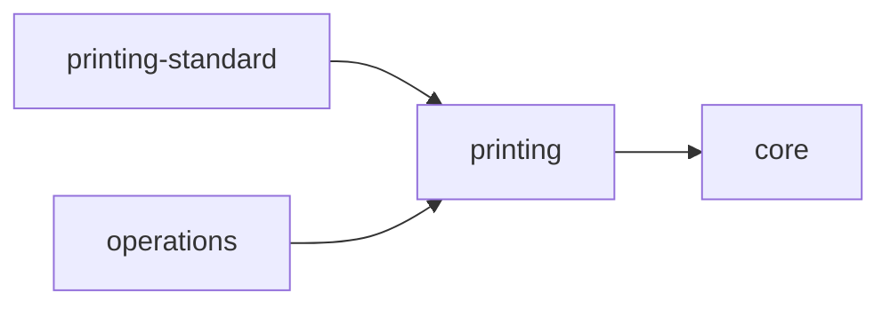
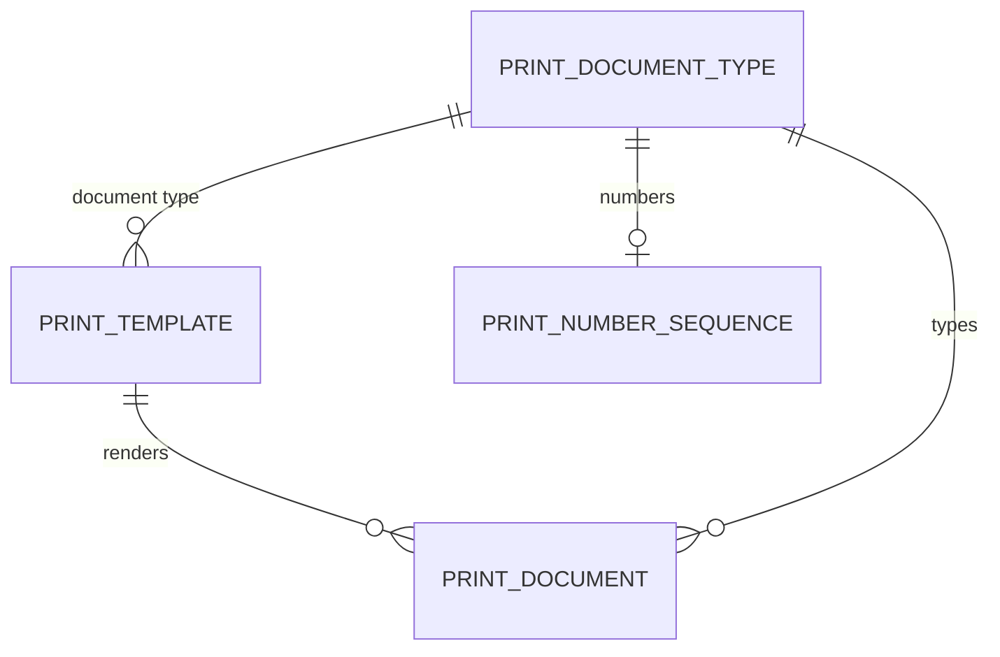
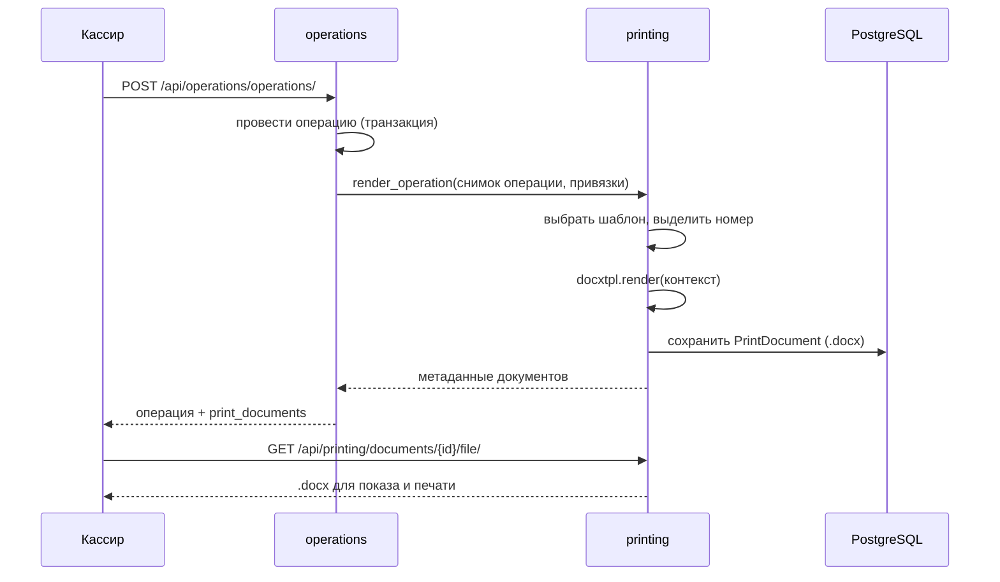

# Архитектура модуля printing

Модуль `printing` отвечает за **печатные документы**: типы документов, шаблоны
Word, нумерацию и сохранённые экземпляры. Модуль `printing_standard` объявляет
базовый тип документа «Кассовый чек» и шаблоны для операций обмена валют.

Общая архитектура продукта — в `docs/architecture.md`, правила модулей и
контрактов — в `docs/modules.md`, решение о печати — в
`docs/adr/0023-print-documents.md`.

## Границы и зависимости

- `printing` зависит от `core` только для проверки доступа к кассам
  (`OrgDirectory.accessible_cash_desk_ids`).
- `operations` зависит от `printing` через контракт: при проведении операции он
  передаёт снимок операции и список включённых шаблонов, а получает сведения о
  созданных документах. Обратного импорта нет.
- `printing_standard` — модуль-объявление. Своих таблиц он не имеет: типы
  документов, шаблоны и функции переменных регистрируются в SPI `printing`.
- Шаблоны конкретных банков добавляются отдельными модулями расширения через тот
  же SPI (аналогично `operations-<bank>`).

## Модель данных

| Сущность | Назначение |
| --- | --- |
| `PrintDocumentType` | Тип печатного документа (сейчас `cash_receipt`), объявлен разработчиком |
| `PrintTemplate` | Шаблон печатной формы: объявленный код + загруженный банком `.docx` |
| `PrintNumberSequence` | Сквозной по банку счётчик номеров на нумеруемый тип документа |
| `PrintDocument` | Отрендеренный документ: файл, номер (может отсутствовать), номер операции и контекст подстановки |

- **Тип документа объявлен разработчиком.** `PrintDocumentType` создаётся
  командой `sync_print_templates` из спецификаций реестра.
- **Шаблон — это данные двух владельцев.** Код, тип документа и функция
  переменных принадлежат объявившему модулю; файл `.docx` загружает и меняет банк.
  Синхронизация обновляет объявленные поля, но **никогда не перезаписывает**
  загруженный файл.
- **Файлы хранятся в базе.** И шаблон, и отрендеренный документ лежат в
  `BinaryField`; файловая система контейнера не используется для пользовательских
  данных.
- **Снимок для повторной печати.** `PrintDocument` хранит готовый `.docx`,
  номер, наименования и контекст подстановки. Даже если шаблон изменится,
  повторная печать воспроизведёт документ, выданный при проведении операции.

## Типы документов, шаблоны и переменные

- **Переменные подстановки** описывает функция-провайдер, объявленная модулем
  (`PrintVariableProvider`). Она перечисляет коды переменных с описаниями и
  собирает значения из `PrintOperationDTO`.
- Администратор видит перечень переменных в интерфейсе и использует их в Word как
  `{{ variable_name }}`. Рендеринг выполняет `docxtpl` (Jinja2 в `.docx`).
- **Привязка к типу операции** принадлежит `operations`
  (`OperationPrintConfig`): для типа операции выбирается один или несколько
  шаблонов, в том числе несколько форм одного типа документа. Каждый шаблон
  выбирается не более одного раза.
- **Нумерация сквозная по банку** и ведётся на тип документа. Поле
  `numbering_scope` задаёт область нумерации; `none` означает, что документы
  этого типа не нумеруются. Если у операции несколько форм одного типа
  документа, каждая получает очередной номер общей последовательности.

## Жизненный цикл

- Рендеринг выполняется **после** проведения операции. Ошибка шаблона не отменяет
  проведённую операцию: она записывается в `PrintTemplate.last_error` и видна
  администратору, а операция остаётся проведённой.
- Повторное проведение с тем же `idempotency_key` не создаёт документы повторно:
  уникальность `(operation_id, template_code)` защищает от дублей.
- Ошибка рендеринга одного шаблона не мешает остальным.

## REST API

Модуль публикует API под `/api/printing/` (полное описание — в `docs/api.md`):

- `templates/` — объявленные шаблоны, их переменные и метаданные файла;
- `templates/{code}/file/` — скачивание и загрузка `.docx`;
- `document-types/` — типы печатных документов;
- `operations/{id}/documents/` — документы операции (для повторной печати);
- `documents/{id}/file/` — скачивание отрендеренного документа.

Права: `printing.templates.view` (просмотр и скачивание шаблонов),
`printing.templates.manage` (загрузка шаблонов), `printing.print` (печать
документов операций). Доступ к документам операции дополнительно ограничен
доступными пользователю кассами.

## Frontend модуля

Страница **«Шаблоны печатных форм»** (`/print-templates`, раздел
«Администрирование») показывает типы документов и объявленные шаблоны. Для каждого
шаблона доступны скачивание, загрузка `.docx`, список переменных подстановки и
последняя ошибка рендеринга. Загрузка доступна с правом
`printing.templates.manage`.

Настройка печатных документов типа операции встроена в страницу **«Типы
операций»** (`operations`): можно добавить несколько печатных документов, в том
числе несколько форм одного типа документа, для каждой выбрать шаблон и
отметить, печатать ли её при проведении. Страница использует API `operations`,
который читает доступные шаблоны через контракт `printing`.

После проведения операции SPA последовательно показывает отрендеренные документы
в модальном окне: их можно отправить на печать (`window.print` с печатным
стилем), скачать в `.docx` или перейти к следующему. В списке последних операций
кнопка «Печать» активна, если при проведении были созданы документы
(`has_print_documents`).

## Состояние реализации

Реализовано:

- типы печатных документов, шаблоны, счётчики и сохранённые документы (схема
  `printing`);
- SPI объявления типов и шаблонов, реестр провайдеров переменных, команда
  `sync_print_templates`, загрузка и скачивание `.docx` через API;
- привязка шаблонов к типам операций (`OperationPrintConfig`) и её API;
- базовый тип «Кассовый чек» и шаблоны для операций «Покупка валюты у клиента»,
  «Продажа валюты клиенту», «Конвертация валюты» (`printing_standard`);
- рендеринг `docxtpl`, банковская нумерация, типы без нумерации, снимки
  документов и повторная печать;
- несколько печатных форм на одной операции, в том числе несколько форм одного
  типа документа;
- страница администрирования шаблонов и настройка печатных документов в «Типах
  операций»; показ документов после проведения и из списка последних операций.

Далее по плану: настраиваемые области нумерации (отделение, касса), банковские
модули-расширения с дополнительными шаблонами, печать в PDF на сервере при
необходимости.

## Ключевые точки входа

- Манифест: `modules/printing/module.yaml`
- Приложение: `modules/printing/backend/apps.py`
- Модели: `modules/printing/backend/models.py`
- Рендеринг и сервис: `modules/printing/backend/rendering.py`
- Реестр шаблонов (SPI): `modules/printing/backend/registry.py`
- Синхронизация: `modules/printing/backend/sync.py`
- REST API: `modules/printing/backend/views.py`
- Контракт: `modules/printing/contracts/__init__.py`
- Базовые объявления: `modules/printing_standard/backend/declarations.py`
- Провайдер переменных чека: `modules/printing_standard/backend/providers.py`
- Привязка к операции: `modules/operations/backend/models.py`
  (`OperationPrintConfig`)
- Мост проведения: `modules/operations/backend/printing.py`
- Модальное окно печати:
  `modules/operations/frontend/components/PrintDocumentsModal.tsx`
