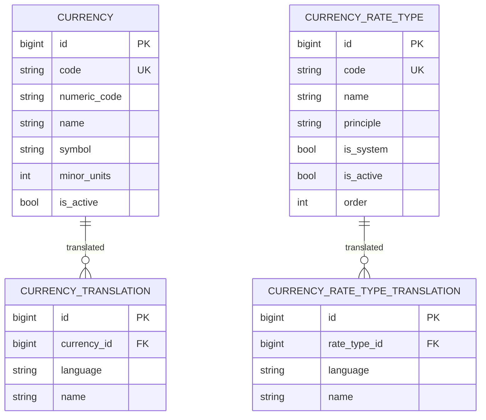

# Архитектура модуля references

Модуль `references` владеет **общесистемными справочными данными**, которые нужны
нескольким модулям и не принадлежат ни одному домену. Он фундаментальный: `core`
и `operations` зависят от него. Решение и обоснование — в
`docs/adr/0017-references-module.md`.

## Назначение

- **Справочник валют (ISO 4217).** Полный список действующих кодов с числовым
  кодом, символом и минорными единицами; названия переводятся (ADR 0016).
- **Типы курсов.** Банковские типы курсов, каждый опирается на один из
  фиксированных принципов (см. ниже).

Валюты и типы курсов адресуются **по коду**; другие модули хранят код строкой, а
не внешним ключом в чужую таблицу (инвариант «данные принадлежат модулю»).

## Публичный контракт

Модуль публикует в реестре (`modules.common.contracts.registry`) один сервис:

- `references.directory` (`ReferenceDirectory`) — чтение словаря валют
  (`currencies`, `get_currency`) и типов курсов (`rate_types`, `get_rate_type`).

Провансер `ReferenceDirectory` реализован в `modules.references.backend.services`.
Конфигурация валют кассы и курсы остаются в контракте `core.cash_desk_config`.

## Схема данных

Схема PostgreSQL — `references`.

## Типы курсов: принцип и банковский тип

- **Принцип** — фиксированный набор констант в контракте
  (`CurrencyRatePrinciple`): `official` (курс Нацбанка), `buy`, `sell`,
  `conversion`. На принцип опирается код операций, поэтому он задан в коде, а не
  данными (по образцу `OperationKind`).
- **Банковский тип** (`CurrencyRateType`) — управляемый банком справочник: у него
  произвольное название и ссылка на принцип. Банк может завести несколько типов
  одного принципа (например «Покупка наличных» и «Покупка безнал»). Системные
  типы (по одному на принцип) поставляются и не удаляются через API.

Курсы (`core.CurrencyRate`) ссылаются на **банковский тип** по коду; принцип
берётся из типа. Выбор и пересчёт по принципу в операциях — следующая итерация.

## Наполнение валют

Справочник наполняется полным списком действующих кодов ISO 4217 командой
`seed_iso_currencies` из статического датасета `backend/catalogue/iso4217.py`. Команда
идемпотентна. Внешняя загрузка (обновление из провайдера) — отдельная будущая
работа.

## Права

- `references.view` — чтение справочников;
- `references.manage` — изменение (создание, правка, удаление).

Каталог прав собирается агрегацией по модулям (ADR 0012).

## Связанные документы

- `docs/adr/0017-references-module.md` — решение о модуле и справочниках.
- `docs/adr/0016-translatable-reference-data.md` — переводы названий.
- `docs/architecture-module-core.md` — конфигурация валют кассы и курсы.
- `docs/api.md` — REST API справочников.
