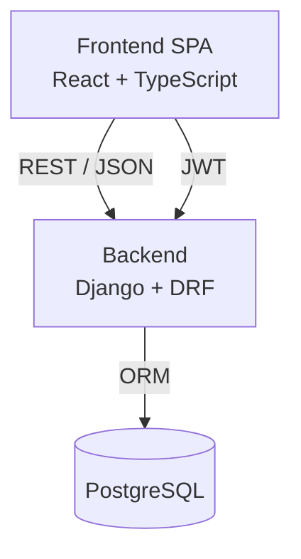
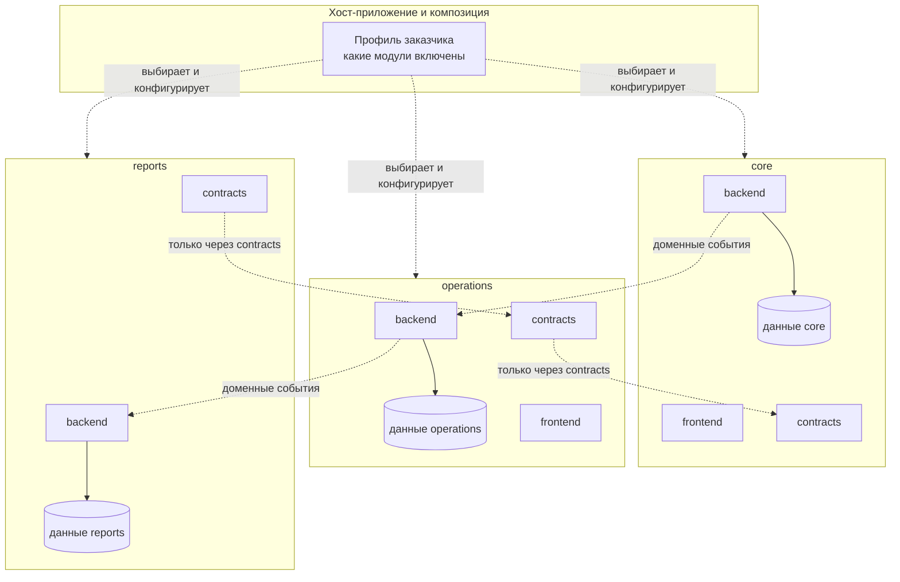
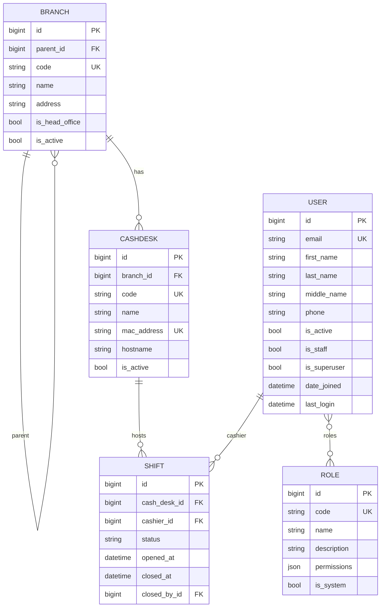

# Архитектура

## Обзор

BankCashOps построен по трёхуровневой архитектуре и развивается как **модульный
монолит со строгими границами** (см. `docs/adr/0001-modular-monolith.md`).

- **Уровень представления** — SPA на React. Работает в браузере, общается с
  backend только по REST/JSON. Такое разделение позволяет позже добавить
  Desktop- и Mobile-клиенты без изменений в backend.
- **Уровень логики** — Django + Django REST Framework. Отдаёт API, содержит
  бизнес-логику и обеспечивает аутентификацию/авторизацию.
- **Уровень данных** — реляционная СУБД PostgreSQL, единая для разработки и
  эксплуатации. Подключение задаётся переменной окружения `DATABASE_URL`.

## Модульная архитектура

Продукт собирается из **модулей**. Каждый модуль — вертикальный срез
функциональности со своими слоями frontend, backend и данных. Модули общаются
только через явные контракты; внутренности модуля скрыты.

Ключевые сущности:

- **Вертикальный модуль** — `modules/<name>/` содержит `backend/`, `frontend/`,
  `contracts/` и манифест `module.yaml`. Модуль владеет своими данными и
  публикует контракт.
- **Frontend** собирается из хоста (`frontend/src/`) и фронтендов модулей
  (`modules/<name>/frontend/`): модуль объявляет маршруты и навигацию манифестом,
  хост подключает их (см. `docs/modules.md`).
- **`common`** — техническая библиотека (базовые модели, пагинация, права,
  примитивы контрактов). Это **не** доменный модуль и не поставляется отдельно.
- **Контракт** — публичный интерфейс модуля (DTO + сервисные интерфейсы +
  события), единственная разрешённая точка зависимости между модулями.
- **Профиль заказчика** — файл композиции: какие модули включены и как они
  находят друг друга (`profiles/`).

Полные правила, формат манифеста и контрактов описаны в `docs/modules.md`.

### Пример состава

| Модуль | Назначение | Поставка |
| --- | --- | --- |
| `core` | Пользователи, аутентификация, роли, оргструктура (отделения, кассы), кассовые смены | всем заказчикам |
| `operations` | Кассовые операции (приход/расход) | опционально |
| `reports` | Отчётность (read-model) | опционально |
| `audit` | Журнал аудита | опционально |

## Аутентификация

Используется JWT (`djangorestframework-simplejwt`):

- `POST /api/auth/login/` возвращает пару `access` + `refresh` и данные
  пользователя.
- `access`-токен передаётся в заголовке `Authorization: Bearer <token>`.
- `POST /api/auth/refresh/` обновляет пару (с ротацией refresh-токена).
- `POST /api/auth/logout/` заносит refresh-токен в чёрный список.

SPA хранит токены в `localStorage` и автоматически обновляет `access`-токен при
получении ответа `401` (см. `frontend/src/api/client.ts`).

## Роли и права

Роли **управляются данными**: они хранятся в таблице `Role` и настраиваются
администратором в интерфейсе, а не зашиты в код. У пользователя может быть
**несколько ролей** (`User.roles` — связь многие-ко-многим).

Каждая роль несёт набор **кодов прав** из каталога
(`modules/core/backend/permission_codes.py`) — например `core.users.manage`
или `core.shifts.open`. Права, выданные всеми ролями пользователя,
объединяются: метод `User.has_permission(code)` возвращает `True`, если код
входит в объединение (суперпользователь имеет все права).

При поставке создаются четыре системные роли: **Администратор**,
**Заведующий отделением**, **Специалист**, **Кассир**. Системные роли нельзя
удалить, но можно переименовать и изменить их права.

Доступ к эндпоинтам проверяет класс `modules.core.backend.permissions.PermissionRequired`,
который сопоставляет действие с кодом права (карта `permission_map` на вьюхе).
Меню и маршруты SPA фильтруются по тем же кодам прав.

## Схема данных (модуль core)

Поле `username` не используется: вход выполняется по `email`.

Удаление пользователя по умолчанию **мягкое** — учётная запись деактивируется
(`is_active = false`), запись сохраняется для аудита. Полное удаление доступно
по `?permanent=true`.

### Отделения и кассы

- Отделения образуют **дерево с единственным головным офисом** (`is_head_office`).
  Ветка не может быть своим предком (проверка при сохранении), глубину не
  ограничиваем. Код отделения — сквозной (`unique`).
- **Касса — это компьютер** (одна касса на один ПК). MAC-адрес хранится как
  учётный атрибут рабочего места (`unique`); автоматическое определение кассы по
  MAC отложено, кассир выбирает кассу вручную при открытии смены.

### Кассовые смены

Смена — **серверный объект**, независимый от сессии/браузера:

- касса выбирается один раз при **открытии смены** и фиксируется на всю жизнь смены;
- одновременно допускается не более **одной открытой смены на кассира** и
  **одной открытой смены на кассу** (частичные уникальные ограничения);
- перезагрузка ПК, потеря токена, несколько вкладок — не влияют на смену;
- забытую смену может закрыть администратор или заведующий отделением
  (право `core.shifts.manage`); авто-закрытия нет.

## Конфигурация

Все параметры, зависящие от окружения, читаются через `django-environ`:

| Переменная | Назначение |
| --- | --- |
| `DJANGO_SECRET_KEY` | Секретный ключ Django |
| `DJANGO_DEBUG` | Режим отладки |
| `DJANGO_ALLOWED_HOSTS` | Разрешённые хосты |
| `DATABASE_URL` | Строка подключения к БД (PostgreSQL) |
| `CORS_ALLOWED_ORIGINS` | Разрешённые источники для браузера |
| `DJANGO_SUPERUSER_*` | Данные начального администратора |

Помимо окружения, состав поставки и связи между модулями задаются профилем
заказчика (`profiles/`), а параметры отдельного модуля — его манифестом
(`modules/<name>/module.yaml`).

## Развитие

Модули добавляются независимо. Текущее состояние: техническая библиотека
`common` и доменный модуль `core` уже живут в `modules/`; в `core` реализованы
пользователи, аутентификация, управляемые данными роли и права, оргструктура
(отделения и кассы) и кассовые смены. Следующие шаги: кассовые операции
(приход/расход), отчётность и аудит.
