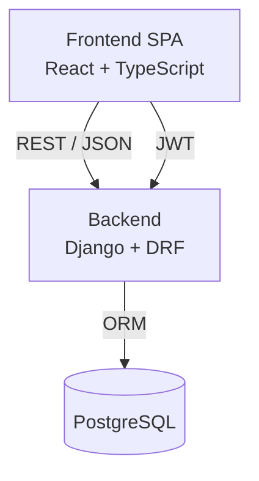
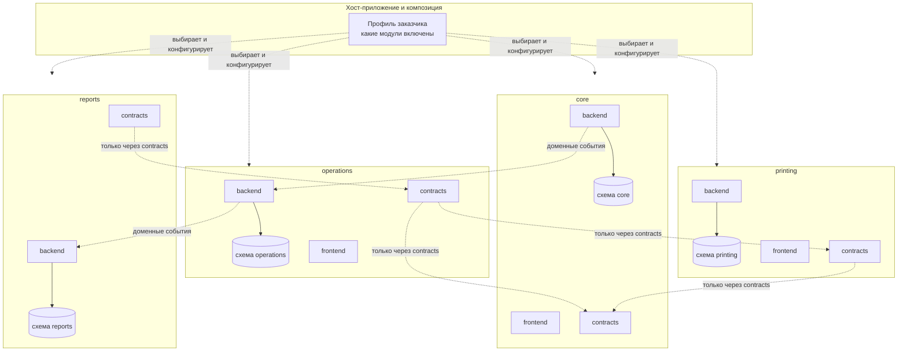

# Архитектура

## Обзор

BankCashOps построен по трёхуровневой архитектуре и развивается как **модульный
монолит со строгими границами** (см. `docs/adr/0001-modular-monolith.md`).

- **Уровень представления** — SPA на React. Работает в браузере, общается с
  backend только по REST/JSON. Такое разделение позволяет позже добавить
  Desktop- и Mobile-клиенты без изменений в backend.
- **Уровень логики** — Django + Django REST Framework. Отдаёт API, содержит
  бизнес-логику и обеспечивает аутентификацию/авторизацию.
- **Уровень данных** — реляционная СУБД PostgreSQL, единая для разработки и
  эксплуатации. Каждый модуль владеет своей схемой PostgreSQL, поэтому данные
  модулей изолированы внутри общей СУБД. Подключение задаётся переменной
  окружения `DATABASE_URL`.

## Модульная архитектура

Продукт собирается из **модулей**. Каждый модуль — вертикальный срез
функциональности со своими слоями frontend, backend и данных. Модули общаются
только через явные контракты; внутренности модуля скрыты.

Ключевые сущности:

- **Вертикальный модуль** — `modules/<name>/` содержит `backend/`, `frontend/`,
  `contracts/` и манифест `module.yaml`. Модуль владеет своими данными и
  публикует контракт.
- **Frontend** собирается из хоста (`frontend/src/`) и фронтендов модулей
  (`modules/<name>/frontend/`): модуль объявляет маршруты и навигацию манифестом,
  хост подключает их (см. `docs/modules.md`).
- **`common`** — техническая библиотека (базовые модели, пагинация, права,
  примитивы контрактов). Это **не** доменный модуль и не поставляется отдельно.
- **Контракт** — публичный интерфейс модуля (DTO + сервисные интерфейсы +
  события), единственная разрешённая точка зависимости между модулями.
- **Профиль заказчика** — файл композиции: какие модули включены и как они
  находят друг друга (`profiles/`).
- **Схема БД** — каждый модуль владеет отдельной схемой PostgreSQL (`core`,
  `operations`); ядро Django остаётся в `public`. Подробности и оговорки — в
  `docs/adr/0013-postgresql-schemas-per-module.md`.

Полные правила, формат манифеста и контрактов описаны в `docs/modules.md`.

### Пример состава

| Модуль | Назначение | Поставка |
| --- | --- | --- |
| `references` | Общесистемные справочники (валюты ISO 4217, типы курсов) | всем заказчикам |
| `core` | Пользователи, аутентификация, роли, оргструктура (отделения, кассы), кассовые смены | всем заказчикам |
| `printing` | Печатные документы: шаблоны Word, нумерация и повторная печать | опционально |
| `printing_standard` | Базовые типы печатных документов и шаблоны (кассовый чек) | с `printing` |
| `operations` | Кассовые операции (приход/расход) | опционально |
| `reports` | Отчётность (read-model) | опционально |
| `audit` | Журнал аудита | опционально |

## Архитектура модулей

Устройство каждого модуля описано в отдельном документе: сущности, диаграммы и
бизнес-правила. Общая архитектура (этот файл) и правила построения модулей
(`docs/modules.md`) — сквозные для всех модулей.

| Модуль | Документ |
| --- | --- |
| `references` | `docs/architecture-module-references.md` |
| `core` | `docs/architecture-module-core.md` |
| `printing` | `docs/architecture-module-printing.md` |
| `printing_standard` | `docs/architecture-module-printing-standard.md` |
| `operations` | `docs/architecture-module-operations.md` |
| `operations_standard` | `docs/architecture-module-operations-standard.md` |

Новый модуль получает файл `docs/architecture-module-<name>.md` и добавляется в
таблицу выше.

## Аутентификация

Используется JWT (`djangorestframework-simplejwt`):

- `POST /api/auth/login/` возвращает пару `access` + `refresh` и данные
  пользователя.
- `access`-токен передаётся в заголовке `Authorization: Bearer <token>`.
- `POST /api/auth/refresh/` обновляет пару (с ротацией refresh-токена).
- `POST /api/auth/logout/` заносит refresh-токен в чёрный список.

SPA хранит токены в `localStorage` и автоматически обновляет `access`-токен при
получении ответа `401` (см. `frontend/src/api/client.ts`).

## Роли и права

Роли **управляются данными** (таблица `Role`), у пользователя может быть
**несколько ролей**, а доступ проверяется по **кодам прав** из каталога, а не по
названию роли. Это сквозной механизм авторизации: им пользуются все модули.
Каталог прав **собирается из модулей**: каждый объявляет свои коды, а интерфейс
ролей показывает объединение (`docs/adr/0012-permission-catalog-aggregation.md`).

Детали реализации модуля `core` (каталог прав, системные роли, класс
`PermissionRequired`) — в `docs/architecture-module-core.md`.

## Локализация

Приложение мультиязычно (ru/en, с возможностью расширения). Язык — свойство
представления и вычисляется **на запрос** (см.
`docs/adr/0015-application-language-layers.md`):

- **Активный язык запроса** — заголовок `Accept-Language` активируется
  `LocaleMiddleware`; `gettext`, сообщения Django/DRF и метки данных резолвятся по
  нему в момент рендера ответа.
- **Персональный выбор** — поле `core.User.language`; SPA отправляет его заголовком
  `Accept-Language`.
- **Дефолт банка** — переменная `BCO_DEFAULT_LANGUAGE` (fallback для анонимных и
  фоновых сценариев).

Приоритет: пользователь → `Accept-Language` → дефолт банка. Строки кода, видимые
пользователю, оборачиваются в `gettext_lazy`; каталоги переводов живут в
`modules/<name>/backend/locale/`. Названия справочников (валюты, типы операций)
переводятся таблицами переводов в модуле-владельце
(`docs/adr/0016-translatable-reference-data.md`), тексты интерфейса — в i18n-ресурсах
модулей.

## Конфигурация

Все параметры, зависящие от окружения, читаются через `django-environ`:

| Переменная | Назначение |
| --- | --- |
| `DJANGO_SECRET_KEY` | Секретный ключ Django |
| `DJANGO_DEBUG` | Режим отладки |
| `DJANGO_ALLOWED_HOSTS` | Разрешённые хосты |
| `DATABASE_URL` | Строка подключения к БД (PostgreSQL) |
| `CORS_ALLOWED_ORIGINS` | Разрешённые источники для браузера |
| `DJANGO_SUPERUSER_*` | Данные начального администратора |
| `BCO_DEFAULT_LANGUAGE` | Язык по умолчанию (`ru`); fallback, когда язык не задан запросом или пользователем |

Помимо окружения, состав поставки и связи между модулями задаются профилем
заказчика (`profiles/`), а параметры отдельного модуля — его манифестом
(`modules/<name>/module.yaml`).

## Развитие

Модули добавляются независимо. Текущее состояние: техническая библиотека
`common` и доменные модули `references`, `core`, `printing`, `operations` и
`operations_standard` уже живут в `modules/`. Модуль `references` владеет
общесистемными справочниками (валюты ISO 4217 и типы курсов) и поставляет их
другим модулям через контракт (`docs/adr/0017-references-module.md`). В `core`
реализованы пользователи, аутентификация, управляемые данными роли и права,
оргструктура (отделения и кассы), валюты касс и шаблоны валют, глобальные
настройки банка, справочник базовых величин, кассовые смены, а также установка
курсов валют с областями «банк / отделение / касса», курсами за количество
единиц и режимом конверсии «через базовую валюту / прямые пары», журналом и
текущими курсами (`docs/adr/0019-currency-rate-setting.md`,
`docs/adr/0020-currency-rate-units-and-conversion.md`). В `operations`
реализовано ядро
операционного учёта: движок проведения, регистры и остатки наличных, журнал
операций, REST API, комплектация кассы с шаблонами (банк и отделения), рабочее
место кассира (SPA) и SPI для расширений; контроль данных клиента по порогу,
декларативные формы операций, много­валютные подкрепление и инкассация, а также
расчёт курсов обмена и индивидуальный курс
(`docs/adr/0021-operation-forms-client-data-and-rates.md`);
`operations_standard` объявляет базовый набор кассовых операций. В `printing`
реализованы типы печатных документов, шаблоны Word в базе, банковская нумерация
и повторная печать, а `printing_standard` объявляет кассовый чек и шаблоны для
операций обмена валют (`docs/adr/0023-print-documents.md`). Реализован outbox
(`common`): `core` и `operations` публикуют доменные события. Далее — отчётность
и аудит.
